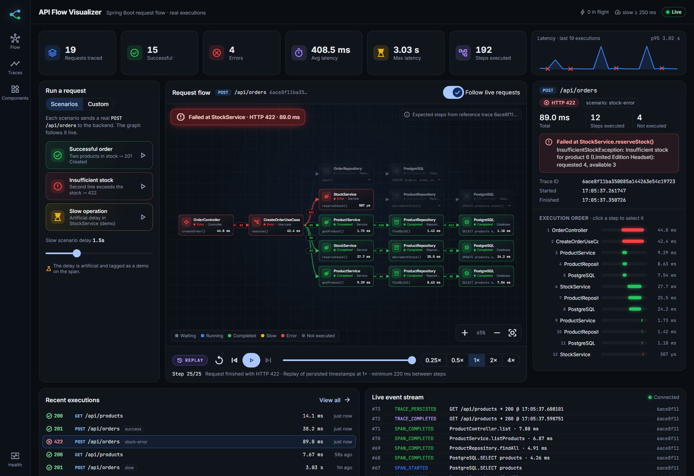
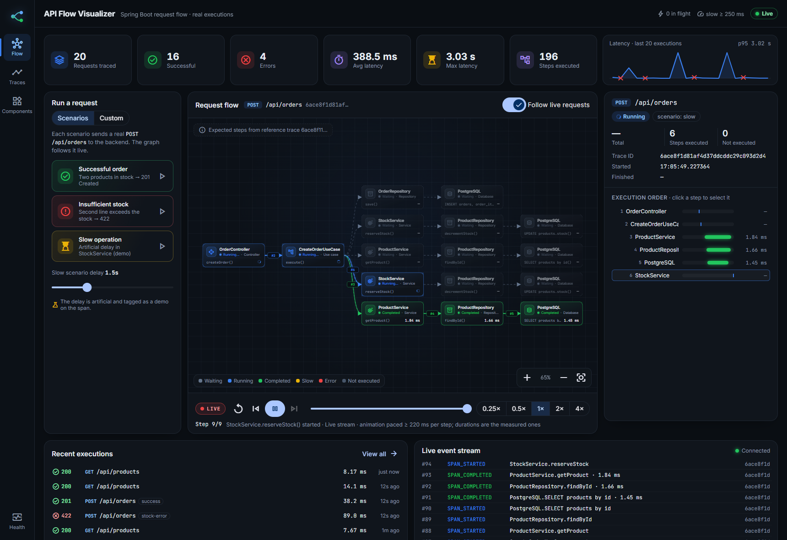
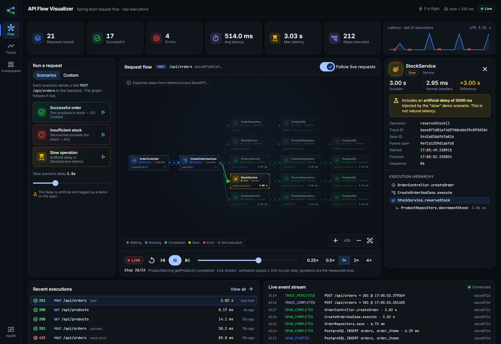
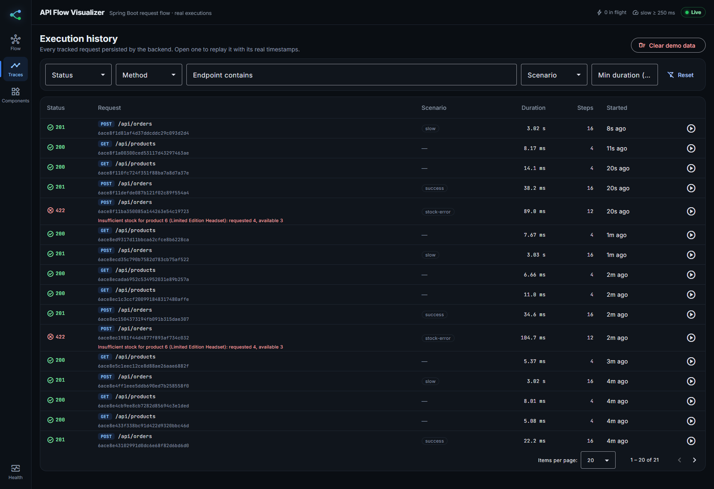
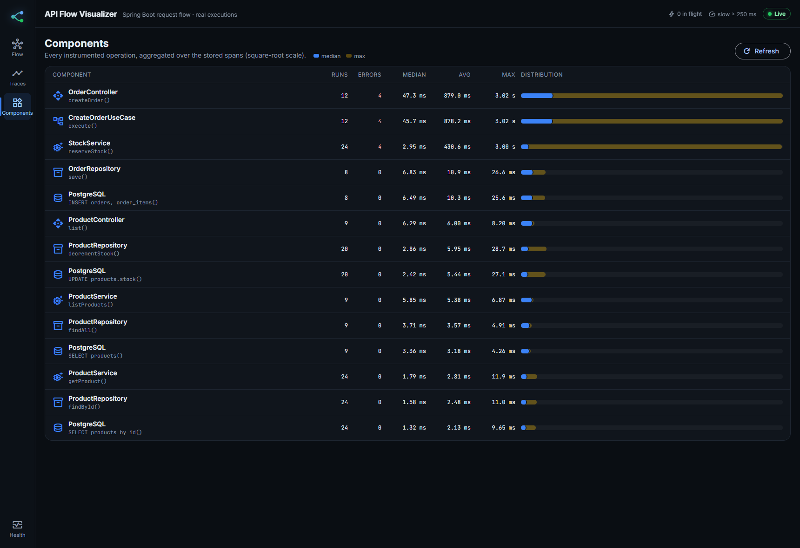
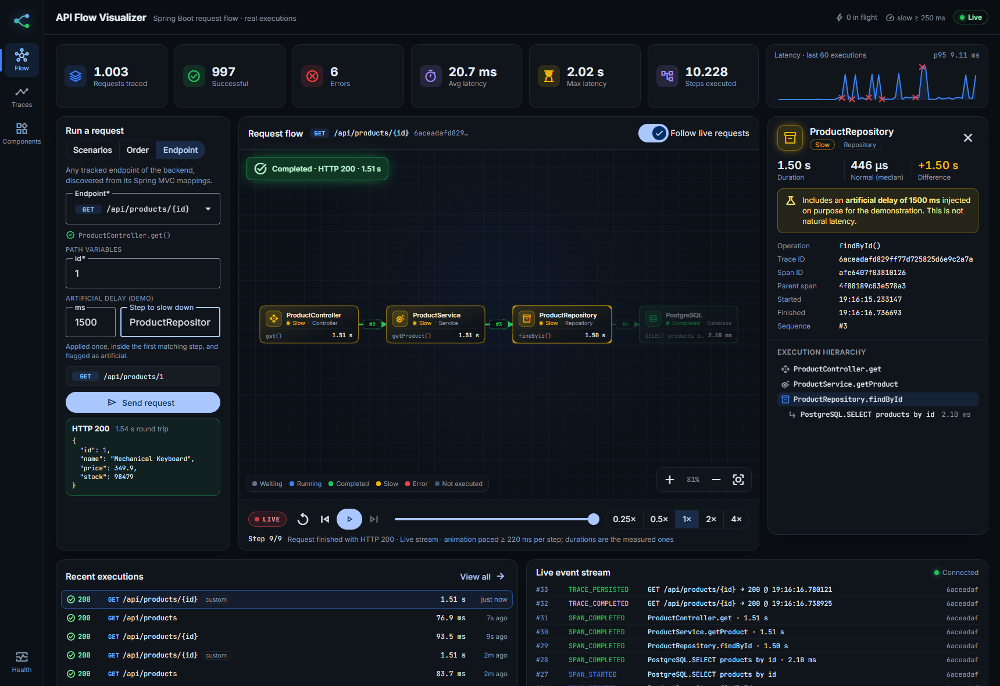
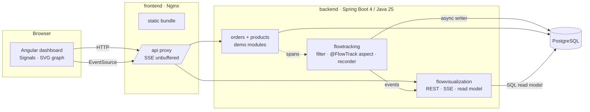
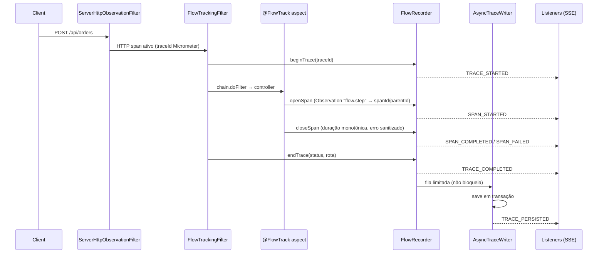

<div align="center">

# API Flow Visualizer

**Veja, em tempo real, o caminho que uma requisição HTTP percorre dentro de uma aplicação Spring Boot**
— do Controller ao PostgreSQL — com durações reais, falhas destacadas e replay de execuções passadas.




</div>

---

## Sumário

- [Objetivo](#objetivo)
- [Destaques](#destaques)
- [Tecnologias](#tecnologias)
- [Início rápido](#início-rápido)
- [Executando os cenários](#executando-os-cenários)
- [Como interpretar o grafo](#como-interpretar-o-grafo)
- [Arquitetura](#arquitetura)
- [Estrutura de pastas](#estrutura-de-pastas)
- [Como funciona a captura de spans](#como-funciona-a-captura-de-spans)
- [Tempo real (SSE) e replay](#tempo-real-sse-e-replay)
- [API de visualização](#api-de-visualização)
- [Persistência e retenção](#persistência-e-retenção)
- [Desempenho e overhead](#desempenho-e-overhead)
- [Testes](#testes)
- [Reutilizando a instrumentação em outro projeto](#reutilizando-a-instrumentação-em-outro-projeto)
- [Configuração](#configuração)
- [Desenvolvimento local (sem Docker)](#desenvolvimento-local-sem-docker)
- [Limitações conhecidas](#limitações-conhecidas)
- [Solução de problemas](#solução-de-problemas)

---

## Objetivo

O **API Flow Visualizer** é uma aplicação full stack que torna visível o funcionamento interno de um
backend Spring Boot. Cada requisição rastreada vira um grafo de componentes conectados — Controller →
Caso de uso → Serviços → Repositórios → Banco — que acende conforme as etapas executam, mostra quanto
tempo cada uma levou e onde uma falha aconteceu.

Tudo o que aparece na tela vem de **execuções reais** capturadas pelo backend. Não há métricas
fabricadas nem animações simuladas: a demonstração dispara requisições HTTP de verdade contra um
monólito modular, e o mecanismo de rastreamento registra o que de fato rodou.

> O objetivo **não** é competir com Jaeger, Zipkin, Grafana ou SigNoz. É uma ferramenta didática e
> visual para entender o fluxo dentro de **uma** aplicação, sem infraestrutura distribuída.

## Destaques

| | |
|---|---|
| **Grafo automático** | Nós posicionados pela hierarquia real dos spans (layout dagre), com zoom, pan, centralização automática, tooltip e destaque do caminho executado. |
| **Tempo real** | Eventos via Server-Sent Events: requisição iniciada, etapa iniciada/concluída/com erro, requisição finalizada. Reconexão com retomada por `Last-Event-ID`. |
| **Replay** | Reproduz execuções persistidas usando os timestamps reais capturados: play, pause, reiniciar, velocidade (0,25× a 4×), passo a passo e seleção de etapa. |
| **Falhas explicadas** | Etapa de origem do erro, exceção de negócio, etapas anteriores concluídas e etapas **não executadas** (inferidas da última execução bem-sucedida do mesmo endpoint). |
| **Lentidão comparada** | Cada etapa é comparada com a mediana das execuções normais da mesma operação. Atrasos artificiais da demo são marcados como tal. |
| **Instrumentação reutilizável** | `@FlowTrack` + `FlowTracker` sobre Micrometer Observation/Tracing, desacoplados das regras de negócio e prontos para virar um Spring Boot Starter. |

<table>
  <tr>
    <td width="50%"><br><sub><b>Ao vivo</b> — StockService executando (azul), etapas seguintes aguardando (tracejadas).</sub></td>
    <td width="50%"><br><sub><b>Detalhes</b> — etapa lenta comparada à mediana normal, com o atraso artificial identificado.</sub></td>
  </tr>
  <tr>
    <td width="50%"><br><sub><b>Histórico</b> — filtros, paginação e replay de qualquer execução.</sub></td>
    <td width="50%"><br><sub><b>Componentes</b> — mediana, média e máximo por operação instrumentada.</sub></td>
  </tr>
</table>

## Tecnologias

**Backend** — `apiflowservice/`

- Java 25 · Spring Boot 4.1 (Web MVC, Data JPA, Validation, Actuator, AspectJ/AOP)
- Micrometer Observation + Micrometer Tracing (bridge Brave, propagação W3C)
- PostgreSQL 18 · Flyway · Maven (wrapper)
- JUnit 5 · Mockito · AssertJ · Testcontainers
- Arquitetura hexagonal organizada por funcionalidade (feature packages)

**Frontend** — `apiflowweb/`

- Angular 22 (standalone components, zoneless, Signals, `computed()`, `effect()`, `rxResource`, `@if`/`@for`/`@switch`)
- Angular Material 22 (tema escuro M3) · Reactive Forms · RxJS · SCSS
- Grafo em SVG: [`@dagrejs/dagre`](https://github.com/dagrejs/dagre) para layout + [`d3-zoom`](https://github.com/d3/d3-zoom) para zoom/pan
- Vitest para testes unitários

**Infraestrutura**

- Docker multi-stage (JDK 25 → JRE 25; Node 24 → Nginx 1.29) · Docker Compose · Nginx como servidor estático e proxy reverso (com SSE sem buffering)

## Início rápido

Pré-requisito: Docker com Docker Compose v2.

```bash
docker compose up --build
```

Quando os três serviços estiverem saudáveis, abra **http://localhost:4200**.

| Serviço | Imagem | Acesso |
|---|---|---|
| `frontend` | Nginx servindo o Angular + proxy de `/api` | `http://localhost:4200` |
| `backend` | Spring Boot em Java 25 | interno (`backend:8080`), exposto via Nginx em `/api` |
| `postgres` | PostgreSQL 18 com volume persistente | interno (`postgres:5432`) |

A ordem de inicialização é garantida por health checks: o backend só sobe com o banco saudável, e o
frontend só sobe com o backend pronto (`/actuator/health/readiness`). O Flyway cria o schema e os
produtos de demonstração automaticamente.

Para personalizar credenciais ou limites, copie o `.env.example` para `.env` (opcional — todos os
valores têm padrão). O `.env` está no `.gitignore`.

## Executando os cenários

No painel **Run a request** do dashboard há três abas: **Scenarios**, **Order** e **Endpoint**. Na primeira há três cenários. Cada um dispara um `POST /api/orders`
**real**; com *Follow live requests* ligado, o grafo acompanha a requisição enquanto ela acontece.

| Cenário | O que acontece | Resultado esperado |
|---|---|---|
| **Successful order** | Pedido com dois produtos em estoque | `201 Created`, todas as etapas verdes |
| **Insufficient stock** | A segunda linha pede mais unidades do que o "Limited Edition Headset" (estoque 3) possui | `422`, falha no `StockService`, `OrderRepository` marcado como *não executado* |
| **Slow operation** | Pedido válido com atraso **artificial** configurável (100 ms – 5 s) no `StockService` | `201`, `StockService` em amarelo, comparação com a mediana normal |

A aba **Order** monta um pedido arbitrário com Reactive Forms (produtos, quantidades e atraso opcional).

### Qualquer endpoint (aba Endpoint)

A aba **Endpoint** lista todos os endpoints rastreados, descobertos dos mapeamentos reais do Spring MVC
(`GET /api/flow/endpoints`). Escolha um, preencha as variáveis de caminho e os parâmetros de query e,
quando houver `@RequestBody`, edite o JSON — um exemplo é gerado automaticamente a partir do tipo do
corpo. O grafo acompanha a requisição e a resposta aparece logo abaixo do botão.

Novos endpoints aparecem nessa lista sem alterar o frontend: basta que a rota esteja em
`flow.tracking.include-paths` (e, para mostrar as etapas, que os métodos tenham `@FlowTrack`).



### Atraso artificial em qualquer etapa

Para demonstrar lentidão em qualquer endpoint, a requisição pode pedir um atraso **artificial** em uma
etapa específica, com dois headers:

| Header | Valor |
|---|---|
| `X-Demo-Delay-Ms` | atraso em ms (até 5000) |
| `X-Demo-Delay-Target` | etapa que recebe o atraso: `Componente` ou `Componente.operação` (padrão: `StockService`) |

Na aba **Endpoint** isso vira dois campos. As etapas sugeridas vêm da última execução do endpoint
escolhido; se ele nunca rodou, a sugestão é o próprio controller (o catálogo já sabe o nome dessa etapa).
Ao informar um atraso, a etapa é preenchida automaticamente com a primeira abaixo do controller, e pode
ser trocada. O atraso é aplicado **uma vez**, dentro da primeira etapa que corresponder — então
ele conta como tempo daquela etapa (e dos seus pais), não dos filhos — e a etapa recebe a tag
`demo.artificialDelayMs`, exibida no painel de detalhes como "atraso artificial". O código de negócio
não sabe disso: o atraso é aplicado por um `SpanStartHook` do módulo de demonstração (veja
[Reutilizando a instrumentação](#reutilizando-a-instrumentação-em-outro-projeto)). Só etapas
instrumentadas podem receber atraso.

```bash
curl -i http://localhost:4200/api/products/1 \
  -H 'X-Demo-Delay-Ms: 1500' -H 'X-Demo-Delay-Target: ProductRepository.findById'
```

### Pela linha de comando

```bash
# Cenário 1 — sucesso
curl -i -X POST http://localhost:4200/api/orders \
  -H 'Content-Type: application/json' -H 'X-Flow-Scenario: success' \
  -d '{"items":[{"productId":1,"quantity":1},{"productId":2,"quantity":2}]}'

# Cenário 2 — estoque insuficiente (HTTP 422)
curl -i -X POST http://localhost:4200/api/orders \
  -H 'Content-Type: application/json' -H 'X-Flow-Scenario: stock-error' \
  -d '{"items":[{"productId":1,"quantity":1},{"productId":6,"quantity":999}]}'

# Cenário 3 — lento (atraso artificial de 1500 ms, apenas demonstração)
curl -i -X POST http://localhost:4200/api/orders \
  -H 'Content-Type: application/json' -H 'X-Flow-Scenario: slow' \
  -H 'X-Demo-Delay-Ms: 1500' -H 'X-Demo-Delay-Target: StockService' \
  -d '{"items":[{"productId":1,"quantity":1}]}'

# Ou peça ao backend para executar o cenário (ele mesmo faz o POST /api/orders via HTTP)
curl -X POST 'http://localhost:4200/api/demo/scenarios/slow?delayMs=2000'
```

Toda resposta rastreada traz o header **`X-Flow-Trace-Id`**. Use-o para abrir a execução:
`http://localhost:4200/?trace=<traceId>`. Mais exemplos (todos os endpoints) estão em
[`docs/requests.http`](docs/requests.http), pronto para o REST Client do VS Code ou o HTTP Client do IntelliJ.

## Como interpretar o grafo

Cada **nó** é um span: um componente executando uma operação. Cada **aresta** liga um span ao seu pai;
o número na aresta (`#3`) é a ordem em que a etapa começou.

| Cor | Estado | Significado |
|---|---|---|
| ⚪ Cinza tracejado | **Aguardando** | Etapa esperada que ainda não começou |
| 🔵 Azul pulsante | **Em execução** | Span aberto neste momento |
| 🟢 Verde | **Concluído** | Terminou sem exceção |
| 🟡 Amarelo | **Lento** | Concluído com duração ≥ limite (`FLOW_SLOW_THRESHOLD`, padrão 250 ms) |
| 🔴 Vermelho | **Erro** | Terminou lançando exceção (a exceção também sobe pelos pais) |
| ⚫ Cinza riscado | **Não executado** | Existia na referência, mas a requisição falhou antes de chegar lá |

- Os estados também aparecem em **texto e ícone** em cada nó — a cor nunca é o único sinal.
- **Etapas esperadas / não executadas** vêm da última execução *bem-sucedida* do mesmo endpoint
  (indicada no canto do grafo como "reference trace"). Isso é inferência a partir de dados reais, não
  simulação; para requisições com outro formato (ex.: número diferente de itens) a referência pode diferir.
- Clique em um nó para ver: componente, operação, traceId, spanId, parentSpanId, início, fim, duração,
  status, erro, a hierarquia completa (ancestrais e filhos) e a **diferença em relação à mediana normal**
  da mesma operação (excluindo execuções com atraso artificial).
- Sem nó selecionado, o painel lateral mostra o resumo da requisição e uma *waterfall* com a ordem de
  execução — clicar em uma linha seleciona a etapa e posiciona o replay nela.
- O controller tem como pai o **span HTTP do servidor** criado pelo Micrometer, que não é uma etapa
  instrumentada — por isso o painel o indica como "(HTTP server span)".

## Arquitetura

Um único backend — **monólito modular**, sem microsserviços. Cada módulo segue arquitetura
hexagonal (`domain`, `application`, `adapter.in`, `adapter.out`) quando faz sentido.



### Módulos do backend

| Módulo | Responsabilidade | Depende de |
|---|---|---|
| `flowtracking` | Captura, correlação, eventos e persistência de rastreamentos. **Não conhece pedidos nem produtos.** | Spring, Micrometer |
| `flowvisualization` | API REST, stream SSE e read model para o dashboard | contratos e domínio de `flowtracking` |
| `orders` | Criação e consulta de pedidos, executor de cenários demo | `products` (serviços), `shared` |
| `products` | Catálogo e reserva de estoque | `shared` |
| `shared` | Exceções de negócio, tratamento de erros (RFC 9457), relógio, latência de demonstração | — |

Regras aplicadas:

- **Domínio puro**: `Product`, `Order`, `FlowSpan`, `FlowTrace`… não dependem de Spring, JPA ou Micrometer.
- **Controllers expõem somente DTOs**; entidades JPA são package-private nos adapters de persistência.
- **CQRS leve**: `flowtracking` escreve com JPA; `flowvisualization` lê com SQL (`JdbcClient`) sobre o
  mesmo schema, sem depender das entidades do outro módulo.
- O módulo de pedidos referencia produtos **por id**, sem relacionamento JPA entre módulos.

### Fluxo real de `POST /api/orders`

```
OrderController.createOrder                      CONTROLLER
└─ CreateOrderUseCase.execute   (@Transactional) USE_CASE
   ├─ ProductService.getProduct                  SERVICE      ┐
   │  └─ ProductRepository.findById              REPOSITORY   │ por item
   │     └─ PostgreSQL · SELECT products by id   DATABASE     │
   ├─ StockService.reserveStock                  SERVICE      │
   │  └─ ProductRepository.decrementStock        REPOSITORY   │
   │     └─ PostgreSQL · UPDATE products.stock   DATABASE     ┘
   └─ OrderRepository.save                       REPOSITORY
      └─ PostgreSQL · INSERT orders, order_items DATABASE
```

A reserva de estoque é um `UPDATE … WHERE stock >= :quantity` atômico, e todo o caso de uso roda em
uma transação: se a segunda linha falhar por estoque, a reserva da primeira é desfeita.

## Estrutura de pastas

```
.
├── apiflowservice/                     # backend (Maven, Java 25)
│   ├── Dockerfile
│   ├── pom.xml
│   └── src/main/java/br/com/joshua/apiflowservice/
│       ├── flowtracking/
│       │   ├── api/                    # contratos públicos: @FlowTrack, FlowTracker, FlowEventListener…
│       │   ├── domain/                 # FlowSpan, FlowTrace, FlowEvent, ErrorSanitizer (Java puro)
│       │   ├── application/            # FlowRecorder, MicrometerFlowTracker, AsyncTraceWriter
│       │   ├── adapter/in/aop/         # FlowTrackAspect
│       │   ├── adapter/in/web/         # FlowTrackingFilter
│       │   ├── adapter/out/persistence # JPA (escrita)
│       │   └── config/                 # wiring + propriedades (futuro auto-configuration)
│       ├── flowvisualization/
│       │   ├── application/            # TraceQueryService, read-model port
│       │   ├── adapter/in/web/         # REST, SSE (FlowEventBroadcaster), DTOs
│       │   └── adapter/out/jdbc/       # read model em SQL
│       ├── orders/  products/          # módulos de demonstração (domain/application/adapter)
│       └── shared/                     # erros, latência de demo, configuração comum
│   └── src/main/resources/db/migration # Flyway V1..V3
├── apiflowweb/                         # frontend (Angular 22)
│   ├── Dockerfile
│   ├── nginx.conf
│   └── src/app/
│       ├── core/                       # API, stream SSE, store de métricas, modelos
│       ├── features/
│       │   ├── flow/graph/             # graph-builder (dagre) + componente SVG
│       │   ├── flow/playback/          # timeline, FlowPlayer (live/replay), controles
│       │   ├── flow/details/           # painel de detalhes e waterfall
│       │   ├── dashboard/              # página principal, cards, runner, histórico, feed
│       │   ├── traces/                 # explorador com filtros e paginação
│       │   └── components/             # métricas por componente
│       └── shared/                     # formatação de tempo, sparkline, ícones
├── docker/certs/                       # (opcional) CAs extras para builds atrás de proxy TLS
├── docs/                               # imagens e requests.http
├── docker-compose.yml
├── .env.example
└── README.md
```

Abra a pasta raiz como um único workspace no IntelliJ IDEA ou VS Code: o backend é reconhecido pelo
`pom.xml` e o frontend pelo `package.json`, com builds independentes.

## Como funciona a captura de spans



1. **Correlação por requisição** — `FlowTrackingFilter` roda dentro do `ServerHttpObservationFilter`
   do Spring, então o `traceId` é o mesmo que o Micrometer Tracing atribuiu à requisição (inclusive o
   recebido via header W3C `traceparent`). O id volta ao cliente no header `X-Flow-Trace-Id`. Só são
   rastreados os caminhos configurados (`/api/orders/**`, `/api/products/**`); `/api/flow/**`,
   `/api/demo/**` e `/actuator/**` são excluídos.
2. **Spans explícitos** — apenas métodos anotados com `@FlowTrack` (ou envolvidos por
   `FlowTracker.track(...)`) viram etapas. Nada é instrumentado por varredura de pacotes.
3. **Micrometer** — cada etapa é uma `Observation` chamada `flow.step`. O handler de tracing cria o
   span (filho do span corrente), de onde vêm `spanId` e `parentSpanId`; a mesma observation gera o
   timer `flow.step` no Actuator, com tags de componente, operação e tipo.
4. **Hierarquia** — o recorder mantém, por requisição, a pilha de spans abertos. Se o tracer não
   estiver disponível, ids são gerados no mesmo formato e o pai vem dessa pilha.
5. **Tempo** — durações usam `System.nanoTime()` (monotônico); os timestamps de cada span são
   derivados do instante de início da requisição mais o deslocamento monotônico, garantindo precisão de
   microssegundos e ordem consistente mesmo onde o relógio de parede é grosseiro.
6. **Banco de dados** — o JPA não expõe cada comando SQL como span, então os adapters de persistência
   envolvem explicitamente a chamada que atinge o PostgreSQL em um span `DATABASE`. `saveAndFlush`
   garante que o `INSERT` execute dentro desse span, e não no commit.
7. **Erros** — exceções são registradas no span e relançadas sem alteração. Exceções tratadas por
   `@RestControllerAdvice` não chegam ao filtro; nesse caso a mensagem do trace vem do span onde a falha
   se originou.
8. **Isolamento de falhas** — erros da própria instrumentação são logados e engolidos: o método de
   negócio continua executando (há teste cobrindo isso).

### Dados sensíveis

- **Nunca** são capturados argumentos de método, valores de retorno, corpos, headers ou query strings.
- O endpoint é gravado como **padrão de rota** (`/api/orders/{id}`), não a URI real.
- Mensagens de erro são truncadas (300 caracteres) e passam por redação de e-mails, sequências
  numéricas longas (cartões), CPFs e pares `password=`/`token=`/`authorization`/`api-key`.
- Tags de span são adicionadas apenas explicitamente, com limite de quantidade e tamanho.

## Tempo real (SSE) e replay

- `GET /api/flow/stream` envia um evento por mensagem SSE com `id` sequencial. Um buffer circular dos
  últimos 1000 eventos permite que o navegador, ao reconectar com `Last-Event-ID`, receba o que perdeu.
  Se o navegador desistir da conexão, o frontend reconecta com backoff exponencial passando
  `?lastEventId=`.
- A cada (re)conexão, o frontend recarrega métricas e o **estado consolidado** do trace que estava
  acompanhando (`GET /api/flow/traces/{id}` consulta primeiro os traces em memória e depois o banco).
- Eventos de requisições diferentes nunca se misturam: todo evento carrega `traceId`, e o player só
  aplica eventos do trace que está seguindo (com deduplicação).
- O envio aos clientes acontece em uma única thread com fila limitada; um cliente lento nunca bloqueia a
  thread da requisição.

**Live vs. Replay** — os dois modos tocam a mesma coisa: uma linha do tempo de eventos reais de
início/fim de span. Em **LIVE** (selo vermelho) os eventos chegam pelo SSE; em **REPLAY** (selo
roxo) a linha do tempo é reconstruída dos timestamps persistidos. A animação respeita os intervalos
reais divididos pela velocidade, com um mínimo de 220 ms entre passos para que etapas de
sub-milissegundo sejam visíveis. **Somente a animação é cadenciada; as durações exibidas são sempre as
medidas.**

## API de visualização

Todas as respostas são DTOs específicos (nenhuma entidade JPA é exposta).

| Método | Endpoint | Descrição |
|---|---|---|
| `GET` | `/api/flow/traces` | Lista paginada; filtros `status`, `method`, `endpoint`, `scenario`, `from`, `to`, `minDurationMs`, `page`, `size` |
| `GET` | `/api/flow/traces/live` | Traces em andamento ou aguardando persistência |
| `GET` | `/api/flow/traces/{traceId}` | Estado consolidado do trace com todas as etapas (`live: true/false`) |
| `GET` | `/api/flow/traces/{traceId}/spans` | Etapas do trace |
| `GET` | `/api/flow/traces/{traceId}/spans/{spanId}` | Etapa + ancestrais + filhos + mediana normal e diferença |
| `GET` | `/api/flow/blueprint?method=&endpoint=` | Etapas da última execução bem-sucedida do endpoint (204 se ainda não houver) |
| `GET` | `/api/flow/endpoints` | Endpoints rastreados (método, rota, variáveis, query params, exemplo de corpo, etapa de entrada) |
| `GET` | `/api/flow/history?limit=` | Últimas execuções em ordem cronológica |
| `GET` | `/api/flow/metrics` | Totais, sucesso, erro, latência média/máxima/p95, total de etapas |
| `GET` | `/api/flow/metrics/components` | Execuções, erros, mediana, média e máximo por operação |
| `DELETE` | `/api/flow/traces` | Limpa os dados de demonstração |
| `GET` | `/api/flow/stream` | Server-Sent Events |
| `GET` | `/api/demo/scenarios` | Lista os cenários |
| `POST` | `/api/demo/scenarios/{success\|stock-error\|slow}?delayMs=` | Executa o cenário via requisição HTTP real |

API de demonstração: `GET/POST /api/products`, `GET /api/products/{id}`, `POST /api/orders`,
`GET /api/orders/{id}`, `GET /api/orders`. Erros seguem o formato RFC 9457 (`application/problem+json`).

## Persistência e retenção

Migrations Flyway em `apiflowservice/src/main/resources/db/migration`:

| Tabela | Conteúdo |
|---|---|
| `trace_execution` | traceId, endpoint (rota), método, status HTTP, cenário, início, término, duração (µs), status, nº de etapas, mensagem de erro |
| `trace_span` | traceId, spanId, parentSpanId, componente, operação, tipo, sequência, início, término, duração (µs), status, tipo/mensagem de erro, tags |
| `products` | id, nome, preço, estoque (6 produtos iniciais; o último com estoque 3 para o cenário de erro) |
| `orders` / `order_items` | pedido (data, status, total) e itens (produto, quantidade, preço unitário) |

Nenhum payload de requisição é persistido. Um job agendado aplica a **retenção** a cada minuto:
mantém no máximo `FLOW_RETENTION_MAX_TRACES` traces (padrão 1000) e remove os mais antigos que
`FLOW_RETENTION_MAX_AGE` (padrão 24 h). Os spans são removidos em cascata.

## Desempenho e overhead

O que a instrumentação faz por etapa: uma `Observation` do Micrometer (span + timer), duas leituras de
relógio, um snapshot imutável do span e o *fan-out* do evento para os listeners — sem serialização de
argumentos e sem I/O na thread da requisição.

Proteções contra acúmulo de memória e escrita síncrona:

| Mecanismo | Limite padrão | Ao exceder |
|---|---|---|
| Traces em memória (rodando ou aguardando gravação) | 500 | a nova requisição não é rastreada (contador `flow.tracking.traces.dropped`) |
| Spans por trace | 200 | spans extras descartados, trace marcado `truncated` |
| Fila de persistência assíncrona (1 thread) | 1000 traces | trace descartado (contador `flow.tracking.persistence.dropped`) |
| Fila de envio SSE (1 thread) | 5000 eventos | descarta os mais antigos |
| Buffer de replay SSE | 1000 eventos | janela circular |
| Assinantes SSE | 100 | conexão recusada |

As métricas `flow.tracking.*` e o timer `flow.step` ficam disponíveis em `/actuator/metrics` no backend.

**Medição** (Windows 11 + Docker Desktop, duas instâncias idênticas da imagem, requisições sequenciais
após aquecimento, latência vista pelo cliente):

| Requisição | Rastreamento ligado (média / p95) | Desligado (média / p95) |
|---|---|---|
| `GET /api/products/{id}` — 4 spans, n=500 | 11,8 ms / 17,8 ms | 9,9 ms / 17,5 ms |
| `POST /api/orders` — 16 spans, n=400 | 14,4 ms / 20,9 ms | 18,2 ms / 27,8 ms |

A diferença ficou **dentro do ruído** desse ambiente (no POST a versão instrumentada foi até mais
rápida), dominado pela rede do Docker Desktop. Ou seja: o custo é pequeno frente a uma ida ao banco,
mas este número não é um benchmark rigoroso. Para medir no seu ambiente, compare
`FLOW_TRACKING_ENABLED=true/false`.

## Testes

```bash
# backend — 50 testes (unitários + integração com PostgreSQL real via Testcontainers; requer Docker)
cd apiflowservice && ./mvnw test

# frontend — 25 testes (Vitest)
cd apiflowweb && npm ci && npx ng test --watch=false
```

| Área | O que é verificado |
|---|---|
| `FlowRecorderTest` | captura de spans, mesmo traceId, hierarquia pai/filho, cálculo de duração com relógio controlado, identificação de erro e origem da falha, ordem dos eventos, traces concorrentes não se misturam, limites de memória, falha de persistência não vaza memória, tags |
| `FlowTrackAspectTest` | spans aninhados via AOP, exceção registrada e relançada, **falha da instrumentação não interrompe o negócio**, self-invocation não interceptada (limitação documentada) |
| `CompositeFlowEventPublisherTest` | listener com erro não impede os demais |
| `ErrorSanitizerTest` | redação de dados sensíveis, truncamento, codec de tags |
| `CreateOrderServiceTest` / `OrderTest` / `ProductTest` | criação de pedidos, ordem das chamadas, validação de estoque, pedido não persistido em caso de falha |
| `FlowTrackingIntegrationTest` | requisição HTTP real → spans com o mesmo traceId e hierarquia correta, spans `DATABASE`, erro de estoque com rollback, atraso artificial atribuído ao `StockService`, **propagação de `traceparent` W3C**, eventos por trace sem mistura, persistência, histórico, filtros, paginação, métricas, blueprint, limpeza |
| `graph-builder.spec.ts` | chaves estruturais, nós/arestas, layout sem sobreposição, cores por estado, etapas aguardando/não executadas |
| `flow-player.spec.ts` | timestamps em µs, reconstrução causal da linha do tempo, cadência mínima e velocidade, seek, eventos ao vivo filtrados por trace e deduplicados |

## Reutilizando a instrumentação em outro projeto

O pacote `flowtracking` não depende dos módulos de negócio e foi organizado para ser extraído como
biblioteca ou Spring Boot Starter:

1. Copie `flowtracking/` (ou empacote-o como um módulo Maven) e garanta as dependências
   `spring-boot-starter-aspectj`, `spring-boot-starter-actuator`, `spring-boot-micrometer-tracing-brave`
   e `micrometer-tracing-bridge-brave` (ou o bridge OpenTelemetry).
2. Importe `FlowTrackingConfiguration` (no starter, registre-a em
   `META-INF/spring/org.springframework.boot.autoconfigure.AutoConfiguration.imports`).
3. Forneça um `TraceRepository` (o `JpaTraceRepository` + migration `V2` servem de referência) ou
   uma implementação própria — em memória, outro banco, envio para um coletor.
4. Anote os métodos que devem aparecer no fluxo:

```java
@FlowTrack(type = ComponentType.SERVICE)                       // componente = nome da classe, operação = método
public Invoice issue(Order order) { ... }

@FlowTrack(type = ComponentType.REPOSITORY, component = "InvoiceRepository")
public Invoice save(Invoice invoice) {
    return tracker.track("PostgreSQL", "INSERT invoices", ComponentType.DATABASE,
            () -> jpa.saveAndFlush(toEntity(invoice)));          // span explícito em volta do SQL
}
```

5. Configure quais rotas abrem um trace:

```yaml
flow:
  tracking:
    include-paths: [/api/invoices/**]
    exclude-paths: [/actuator/**]
```

| Contrato (`flowtracking.api`) | Papel |
|---|---|
| `@FlowTrack` | marca um método como etapa do fluxo |
| `FlowTracker` / `FlowScope` | criação de spans explícita (`track(...)`, `startSpan(...)`, `tag(...)`) |
| `ComponentResolver` | identificação de componentes (convenções de nome) |
| `FlowEventListener` | captura de eventos — implemente para receber o ciclo de vida dos traces |
| `FlowEventPublisher` | publicação de eventos (padrão: fan-out isolado para todos os listeners) |
| `TraceRepository` | persistência de rastreamentos (escrita) |
| `InFlightTraces` | leitura de traces ainda em memória |
| `SpanStartHook` | extensão executada no início de cada etapa (usada pelo atraso artificial da demo) |

O módulo `flowvisualization` é um exemplo de consumidor: implementa `FlowEventListener` para o SSE e
lê o schema via SQL, sem conhecer pedidos ou produtos.

## Configuração

| Variável (`.env` / ambiente) | Padrão | Efeito |
|---|---|---|
| `POSTGRES_DB` / `POSTGRES_USER` / `POSTGRES_PASSWORD` | `apiflow` | credenciais do banco (use segredos reais fora de demonstrações) |
| `FRONTEND_PORT` | `4200` | porta do dashboard no host |
| `FLOW_SLOW_THRESHOLD` | `250ms` | duração a partir da qual uma etapa é "lenta" |
| `FLOW_RETENTION_MAX_TRACES` | `1000` | quantidade máxima de traces armazenados |
| `FLOW_RETENTION_MAX_AGE` | `24h` | idade máxima dos traces |
| `FLOW_TRACKING_ENABLED` | `true` | liga/desliga a abertura de traces |

Demais propriedades (`flow.tracking.*`, `flow.visualization.*`) estão documentadas em
`apiflowservice/src/main/resources/application.yml`.

## Desenvolvimento local (sem Docker)

```bash
# 1) banco
docker run -d --name apiflow-pg -e POSTGRES_DB=apiflow -e POSTGRES_USER=apiflow \
  -e POSTGRES_PASSWORD=apiflow -p 5432:5432 postgres:18-alpine

# 2) backend (Java 25) em http://localhost:8080
cd apiflowservice && ./mvnw spring-boot:run

# 3) frontend em http://localhost:4200 (proxy de /api para :8080 via proxy.conf.json)
cd apiflowweb && npm install && npm start
```

O Angular usa apenas URLs relativas (`/api/...`); por isso não há CORS configurado — em produção o
Nginx faz o proxy, e em desenvolvimento o dev-server do Angular.

## Limitações conhecidas

- **AOP baseado em proxy**: chamadas internas (`this.metodo()`) não são interceptadas; métodos
  `private`/`final` também não. Use `FlowTracker.track(...)` nesses pontos.
- **Escopo de thread**: o contexto do trace é ligado à thread da requisição. Trabalho em outras threads
  (`@Async`, `CompletableFuture`, executores) não é rastreado nesta versão. Virtual threads funcionam,
  pois cada requisição continua em uma única thread.
- **SQL**: apenas as chamadas envolvidas explicitamente aparecem como `DATABASE`. Flushes implícitos no
  commit, lazy loading e consultas geradas pelo Hibernate fora desses pontos não viram spans.
- **Etapas "não executadas"** são inferidas da última execução bem-sucedida do mesmo endpoint; se a
  requisição tiver outro formato, a comparação pode não corresponder exatamente.
- **Persistência assíncrona**: um trace só aparece nas consultas ao banco alguns milissegundos após a
  resposta (enquanto isso, é servido da memória). Sob sobrecarga, traces podem ser descartados — por
  projeto, a instrumentação nunca bloqueia a aplicação.
- **Mensagens de erro** passam por redação heurística; não substitui uma política formal de dados.
- **Um único nó**: o buffer de replay SSE e os traces em memória não são compartilhados entre
  instâncias. Com várias réplicas, seria preciso um mecanismo distribuído — fora do escopo.
- **Não é uma plataforma de observabilidade**: não há exportação OTLP, amostragem, propagação entre
  serviços nem armazenamento de longo prazo. Para isso, use Jaeger/Tempo/Zipkin/SigNoz — os spans do
  Micrometer deste projeto podem ser exportados para eles adicionando um reporter.

## Solução de problemas

**`certificate verify failed` durante o `docker compose up --build`** — sua rede inspeciona TLS
(proxy corporativo ou antivírus com "web shield"). Exporte o certificado raiz que faz a inspeção em
formato PEM, salve como `docker/certs/<nome>.crt` e rode `docker compose build --no-cache`. Os
certificados são confiados apenas nos estágios de build. Veja [`docker/certs/README.md`](docker/certs/README.md).

**Porta 4200 ocupada** — defina `FRONTEND_PORT=8081` no `.env`.

**Dashboard sem eventos ao vivo** — confira o indicador no canto superior direito (Live / Reconnecting).
O Nginx já está configurado com `proxy_buffering off` para `/api/flow/stream`; se houver outro proxy na
frente, desative o buffering dele para `text/event-stream`.

**Recomeçar do zero** — `docker compose down -v` remove também o volume do PostgreSQL.
